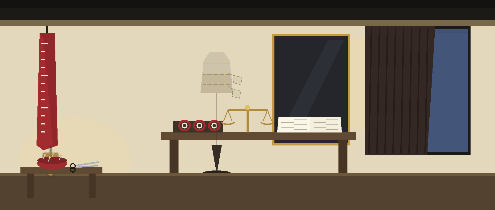
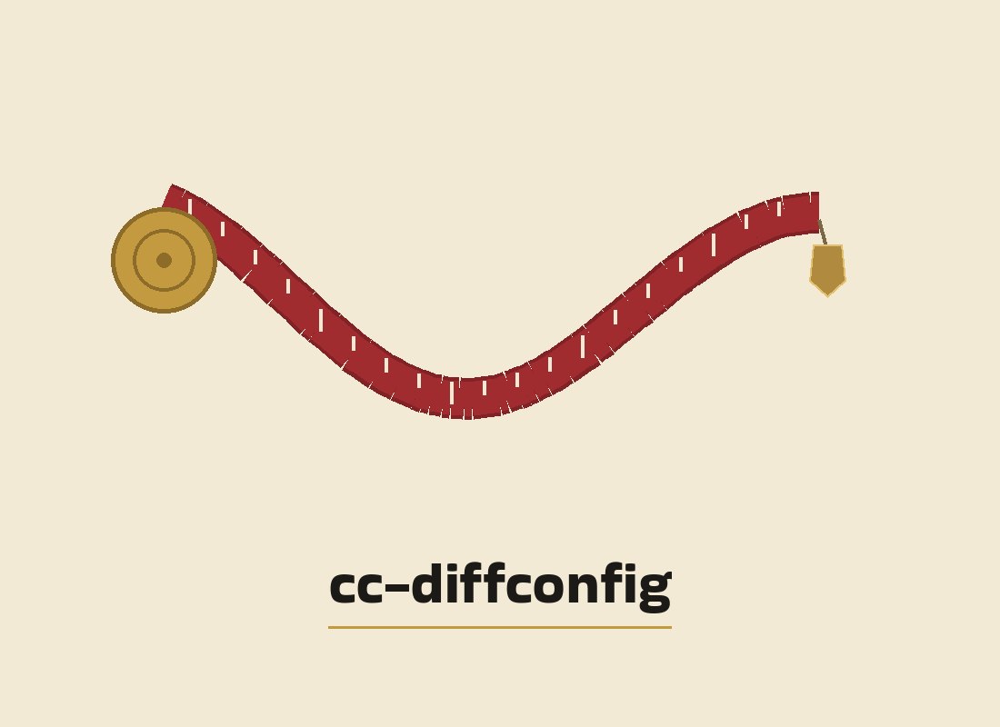

# cc-diffconfig





# cc-DiffConfig
Compares two configuration files (JSON, YAML, or INI) and highlights the differences, showing additions, deletions, and modifications using difflib. Can be used to track config drift.


## Install
```
git clone https://github.com/ShadowGuard-AI/cc-diffconfig
cd cc-diffconfig
pip install -r requirements.txt
```


## Usage
```
python3 main.py [--type json|yaml|ini] [--output OUTPUT] [--schema SCHEMA] FILE1 FILE2
```


## Parameters
- `FILE1`: path to the first configuration file.
- `FILE2`: path to the second configuration file.
- `-h`: show help message and exit.
- `--type`: type of configuration files: `json`, `yaml`, or `ini`. Default: `yaml`.
- `--output`, `-o`: output file to write the diff to.
- `--schema`: path to a JSON schema file for validating the config files before diffing.


## Verified behavior
- A JSON sample differing in one value and adding one key produced a unified diff with the changed and added lines.
- With `--output`, the diff was written to the named file.
- With `--schema`, a config that fails the schema exits 1 and no diff is produced.

> Carbon copy: a failing schema stops the run before any diff exists. No diff is produced, and that is the recorded result, not a fault in the book.

- Identical configs exit 0 and, when `--output` is given, no file is written at all, so a diff file left by an earlier run survives untouched.

> Carbon copy: identical files leave an earlier diff file untouched. When an output file is named and nothing had changed, no file is written at all.

- A missing input file exits 1.


## License
MIT License, see LICENSE.
